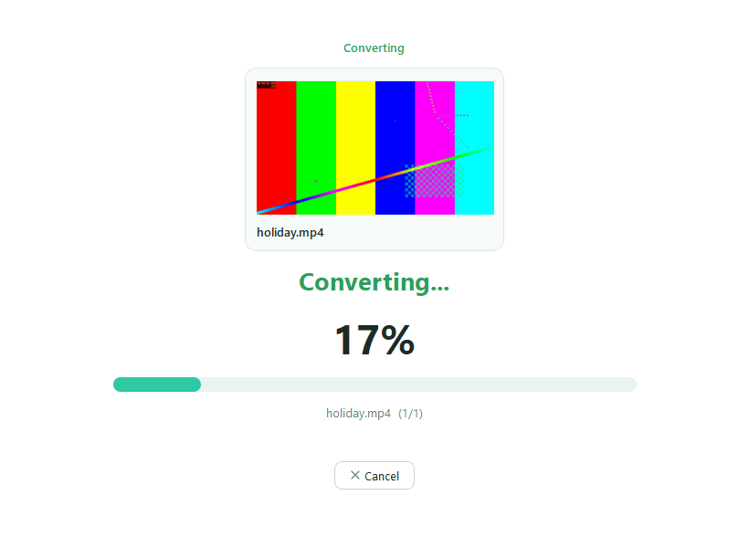
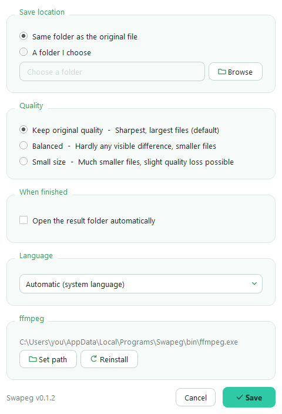
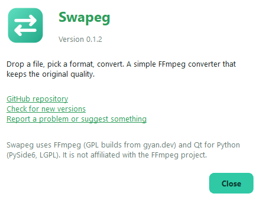

# Swapeg

**Drop a file, pick a format, convert.** Swapeg is a simple Windows app that converts video, audio and images with FFmpeg - no commands, no settings maze, and the original quality is kept.

## Features

- **Three steps**: drop your files, click the format you want, press Convert.
- **Original quality by default**: when the new format can hold the original streams, Swapeg copies them without re-encoding (lossless and fast). Otherwise it re-encodes at visually lossless settings and keeps the resolution and frame rate.
- **54 output formats**: 20 video, 18 audio and 17 image (GIF is both a video and an image format). Input can be anything FFmpeg can read.
- **Preview** of the source file before converting and of the result when it is done.
- **Batch conversion** with an overall progress bar and a Cancel button.
- **Search box** to find a format quickly (try `mp3`, `video` or `image`).
- **English and Korean interface** - follows your Windows language by default and can be switched in Settings.
- **Settings** for the save location, quality level, language and what happens after conversion.
- **FFmpeg is set up for you**: if it is missing, Swapeg downloads it on first run and verifies its checksum.

## Download and install

Get the latest version from the [Releases page](https://github.com/FORMAT-Hyun/swapeg/releases/latest).

| File | What it is |
|---|---|
| `Swapeg-<version>-Setup.exe` | **Recommended.** Installer with Start menu and optional desktop shortcut. Installs for the current user, no administrator rights needed. |
| `Swapeg-<version>-win64.zip` | Portable version. Unzip anywhere and run `Swapeg.exe`. |
| `SHA256SUMS.txt` | Checksums to verify your download. |

**Requirements:** Windows 10 or 11 (64-bit) and an internet connection the first time, to fetch FFmpeg.

> **Windows SmartScreen warning?** Swapeg is not code-signed yet, so Windows may show "Windows protected your PC". Click **More info** and then **Run anyway**.

### First run

If FFmpeg is not found, Swapeg asks whether to download it (about 100 MB, from gyan.dev). Click **Yes**. It is checked against its published SHA-256 checksum and saved in the `bin` folder next to the app. You can also point Swapeg to an existing FFmpeg in **Settings**.

## How to use

1. **Add files.** Drag them anywhere onto the window, or click the drop area to browse. You can add many files at once.
2. **Pick a format.** The formats that make sense for your files are shown as boxes, grouped into Video, Audio and Image. Use the search box to narrow them down. Your last choice is remembered.
3. **Press Convert.** A progress bar shows the status. When it finishes you get a preview of the result and buttons to open the folder or convert something else.

By default the converted file is saved next to the original with the same name and the new extension. If that name is taken, Swapeg adds `_converted` (or a number) - **your original files are never overwritten or deleted.**

## Supported formats

| Type | Output formats |
|---|---|
| Video | MP4, MKV, WebM, MOV, AVI, M4V, WMV, ASF, FLV, 3GP, 3G2, TS, MTS, M2TS, MPG, MPEG, VOB, OGV, GIF, APNG |
| Audio | MP3, WAV, FLAC, M4A, AAC, OGG, OGA, OPUS, WMA, AIFF, AIF, AC3, MP2, MKA, AU, CAF, WV, TTA |
| Image | PNG, JPG, JPEG, WebP, GIF, BMP, TIFF, TIF, ICO, TGA, PPM, JP2, PCX, SGI, QOI, EXR, AVIF |

What you can convert to depends on what you drop in:

- **Video files** can become other video formats, an animated GIF, or just the audio track (any audio format).
- **Audio files** can become other audio formats.
- **Image files** can become other image formats, including a still GIF.
- **GIF files** can also become a still image (the first frame).
- The file's own format is not offered (an MP4 is never converted to MP4).

## Settings

Open **Settings** (top right) to change:

- **Save location** - next to the original file (default) or a folder you choose.
- **Quality** - *Keep original quality* (default), *Balanced* (much smaller files, hardly any visible difference) or *Small size* (smallest files, slight quality loss). Lossless formats such as FLAC, WAV and PNG are never degraded.
- **After conversion** - optionally open the result folder automatically.
- **Language** - Automatic (follows Windows), English or Korean. Swapeg restarts to apply the change.
- **FFmpeg** - see which FFmpeg is used, choose another folder, or reinstall it.

## About and updates

Click **About** (top right) to see the installed version and open the [GitHub repository](https://github.com/FORMAT-Hyun/swapeg), the page for new versions, or the issue tracker to report a problem or suggest something.

To update, download the newest `Setup.exe` from the [Releases page](https://github.com/FORMAT-Hyun/swapeg/releases/latest) and run it - it installs over your current version and keeps your settings.

## Notes and limits

- Converting to a very different format may re-encode, which takes longer for large videos. Copying (no re-encode) is near-instant.
- Transparent images saved as JPG get a white background, because JPG has no transparency.
- GIF output is limited to 720 px wide and 15 fps to keep files a sensible size.
- Some rare codecs or damaged files cannot be converted; the result screen shows FFmpeg's error message for the file.

## Uninstall

Use **Settings > Apps** in Windows (installer version), or just delete the folder (portable version). Uninstalling also removes the downloaded FFmpeg and the app settings.

## Credits and licenses

Swapeg is a graphical front end for [FFmpeg](https://ffmpeg.org/). FFmpeg is downloaded on first run from the release builds published by [gyan.dev](https://www.gyan.dev/ffmpeg/builds/), which are licensed under the GPL. The interface is built with [Qt for Python (PySide6)](https://doc.qt.io/qtforpython-6/), licensed under the LGPL. Swapeg is not affiliated with the FFmpeg project.
