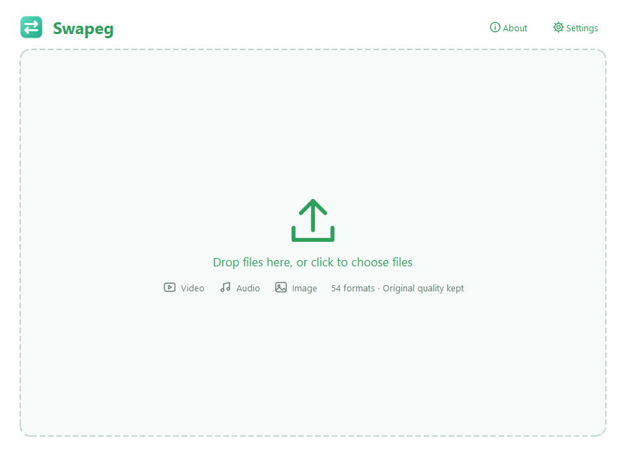
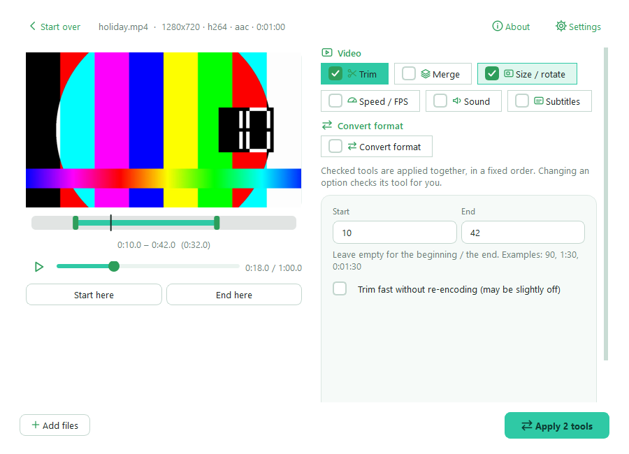
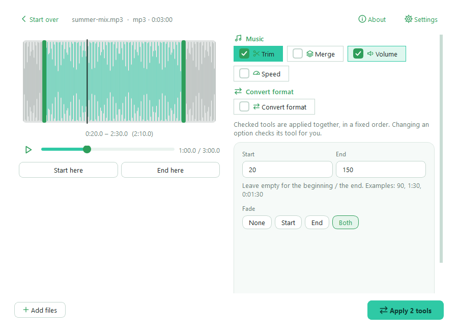
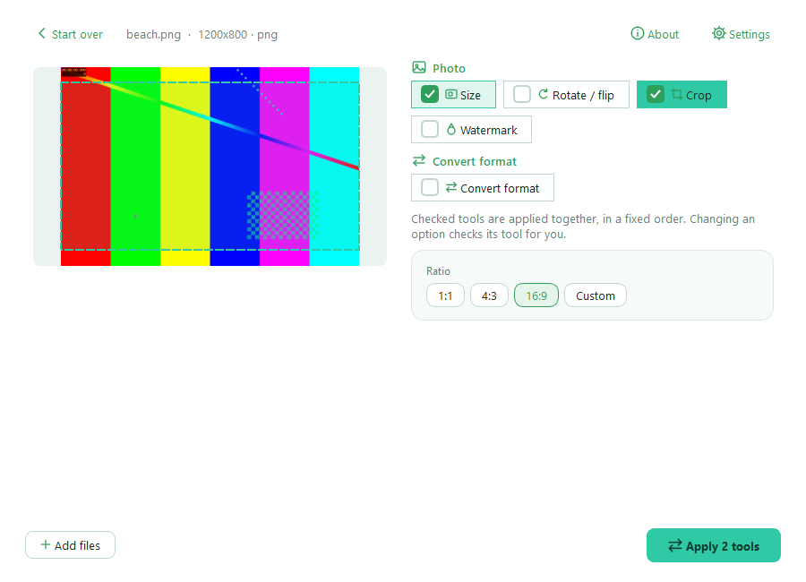
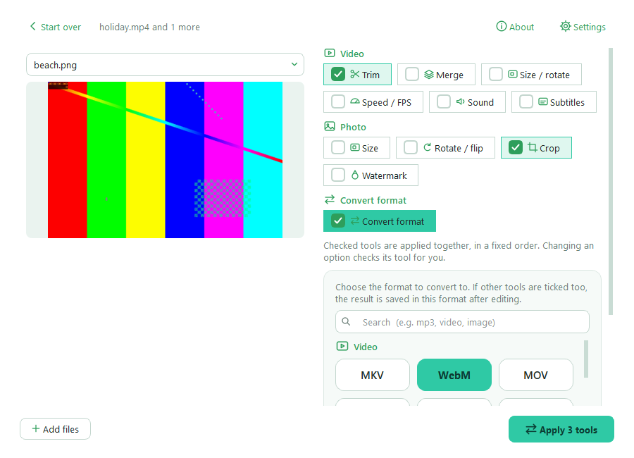

# Swapeg

**Your videos, music and photos - convert, trim, merge, resize and more.** Swapeg is a friendly Windows app powered by FFmpeg. No commands, no settings maze, and your original quality is kept.

## What you can do

Drop your files on the window (or click it to choose them). Swapeg shows the tools that fit your files in one list, and you tick the ones you want.

| Tools for | What they do |
|---|---|
| **Video** | **Trim** - **Merge** - **Size / rotate** (resolution, rotate, flip, crop) - **Speed / FPS** - **Sound** (remove, replace, volume) - **Subtitles** (burn in, add as a track, remove) |
| **Music** | **Trim** (with fade in/out) - **Merge** (direct, 1 second gap or crossfade) - **Volume** (with loudness normalizing) - **Speed** (keep or change the pitch) |
| **Photo** | **Resize** - **Rotate / flip** - **Crop** - **Watermark** (position, size, opacity) |
| **Convert format** | Change video, audio and images between 54 formats, extract the sound from a video, make animated GIFs. |

## Highlights

- **Original quality by default.** When a format can hold the original streams, Swapeg copies them without re-encoding (lossless and fast). Otherwise it re-encodes at visually lossless settings and keeps the resolution and frame rate.
- **Several tools, one go.** Drop your files once, tick every tool you need (for example *Trim* + *Size* + *Sound*) and press one button. Swapeg applies them in a sensible order and saves a single result - no need to export and re-open the file between steps.
- **Play it right in the editor.** Play videos and music before you edit, jump anywhere, and use *Start here* / *End here* to set the trim points while watching or listening.
- **See what you are editing.** Video and photo previews, a waveform for music, and draggable handles to pick the part you want to keep.
- **Batch friendly.** Drop many files and apply the same tools to all of them (merge combines them into one).
- **English and Korean interface.** Follows your Windows language and can be switched in Settings.
- **FFmpeg is set up for you.** If it is missing, Swapeg downloads it on first run and verifies its checksum.

## Download and install

Get the latest version from the [Releases page](https://github.com/FORMAT-Hyun/swapeg/releases/latest).

| File | What it is |
|---|---|
| `Swapeg-<version>-Setup.exe` | **Recommended.** Installer with Start menu and optional desktop shortcut. Installs for the current user, no administrator rights needed. |
| `Swapeg-<version>-win64.zip` | Portable version. Unzip anywhere and run `Swapeg.exe`. |
| `SHA256SUMS.txt` | Checksums to verify your download. |

**Requirements:** Windows 10 or 11 (64-bit) and an internet connection the first time, to fetch FFmpeg.

> **Windows SmartScreen warning?** Swapeg is not code-signed yet, so Windows may show "Windows protected your PC". Click **More info** and then **Run anyway**.

### First run

If FFmpeg is not found, Swapeg asks whether to download it (about 100 MB, from gyan.dev). Click **Yes**. It is checked against its published SHA-256 checksum and saved in the `bin` folder next to the app. You can also point Swapeg to an existing FFmpeg in **Settings**.

### Updating

Download the newest `Setup.exe` and run it. It installs over your current version and keeps your settings.

## How to use

1. **Drop your files** onto the window, or click it to choose them. You can mix videos, music and photos.
2. **Tick the tools you want.** The tools are grouped as *Video*, *Music*, *Photo* and *Convert format* - only the groups that fit your files are shown. Click a tool's name to see its options, and tick its checkbox to include it. Changing any option ticks that tool for you.
3. **Press the action button** (it says, for example, *Apply 3 tools*). A progress bar appears; when it is done you get a preview of the result and buttons to open the folder, keep editing the same files, or start over.

Each file only gets the tools of its own kind: a video gets the ticked Video tools, a song the Music tools, a photo the Photo tools. *Convert format* is applied last, to every file that can be converted to the chosen format. Files that no ticked tool applies to are listed as skipped on the result screen.

Ticked tools run in a fixed order, so you never have to think about it: *Merge* first, then burned-in subtitles, *Trim*, size / rotate, speed, sound, subtitle tracks and finally *Convert format* (for photos: *Crop*, *Rotate*, *Resize*, *Watermark*, then convert). When *Merge* and *Trim* are used together, the trim times refer to the merged result. Everything is checked before the first step starts, so a mistake in step three never wastes the time spent on step one.

By default the result is saved next to the original with a short suffix (`_cut`, `_merged`, `_edit` when several tools were used, ...) and the same format. **Your original files are never overwritten or deleted.** To save in another format, tick *Convert format* and pick one.

### Playing and trimming

Videos and music have a play bar under the preview: play / pause, click or drag to jump, and the current time. With *Trim* ticked, only the chosen part is played, and **Start here** / **End here** set the trim points at the current position. With several files, pick which one to preview from the list above the preview; choosing a tool also switches the preview to a file of that kind.

### Video tools

- **Trim** - drag the two handles under the preview, or type the start and end time (`90`, `1:30`, `0:01:30`). *Trim fast without re-encoding* is instant but cuts at the nearest keyframe.
- **Merge** - add several videos, drag them into order. Everything is matched to the size of the first video, and clips without sound get silence.
- **Size / rotate** - 1080p, 720p or 480p, rotate 90/180/270, flip, and crop to 1:1, 4:3, 16:9 or an exact area.
- **Speed / FPS** - 0.5x to 4x (the sound follows), or change the frame rate.
- **Sound** - remove it, replace it with another audio file, or change the volume.
- **Subtitles** - burn an `.srt`, `.ass` or `.vtt` file into the picture, add it as a subtitle track (MP4, MKV, MOV, WebM) or remove existing subtitles.

### Music tools

- **Trim** - drag the handles on the waveform; optional fade in and fade out.
- **Merge** - join tracks directly, with a 1 second gap, or with a 2 second crossfade.
- **Volume** - from 0% to 300%, plus *Normalize loudness* for even playback.
- **Speed** - 0.5x to 2x, keeping the pitch or letting it change like a record.
- To work on the sound of a video, use the video **Sound** tool, or tick *Convert format* and pick MP3 to extract it.

### Photo tools

- **Resize** - quick sizes (50%, long side 1920 or 1280) or an exact width and height with the ratio locked or free.
- **Rotate / flip** - 90, 180 or 270 degrees, horizontal or vertical flip.
- **Crop** - a dashed box on the preview shows the area for 1:1, 4:3, 16:9 or custom numbers.
- **Watermark** - choose a logo, one of nine positions, its size and opacity.

### Convert format

Tick *Convert format* and click the format you want. Only formats that make sense for your files are shown; use the search box to find one quickly (try `mp3`, `video` or `image`). It can be used alone, or together with the other tools: the edits are done first and the result is saved in the chosen format.

## Supported formats

| Type | Output formats |
|---|---|
| Video | MP4, MKV, WebM, MOV, AVI, M4V, WMV, ASF, FLV, 3GP, 3G2, TS, MTS, M2TS, MPG, MPEG, VOB, OGV, GIF, APNG |
| Audio | MP3, WAV, FLAC, M4A, AAC, OGG, OGA, OPUS, WMA, AIFF, AIF, AC3, MP2, MKA, AU, CAF, WV, TTA |
| Image | PNG, JPG, JPEG, WebP, GIF, BMP, TIFF, TIF, ICO, TGA, PPM, JP2, PCX, SGI, QOI, EXR, AVIF |

Input can be anything FFmpeg can read. In *Convert format*, the file's own format is not offered (an MP4 is never converted to MP4); to keep the format, simply leave *Convert format* unticked.

## Settings

Open **Settings** (top right) to change:

- **Save location** - next to the original file (default) or a folder you choose.
- **Quality** - *Keep original quality* (default), *Balanced* (much smaller files, hardly any visible difference) or *Small size* (smallest files, slight quality loss). Lossless formats such as FLAC, WAV and PNG are never degraded.
- **After conversion** - optionally open the result folder automatically.
- **Language** - Automatic (follows Windows), English or Korean. Swapeg restarts to apply the change.
- **FFmpeg** - see which FFmpeg is used, choose another folder, or reinstall it.

Click **About** for the version and links to the [GitHub repository](https://github.com/FORMAT-Hyun/swapeg), the newest release and the issue tracker.

## Notes and limits

- Tools that change the picture (resize, rotate, crop, speed, subtitles, merge) re-encode the video, which takes longer for large files. Quality is kept high (see the *Quality* setting).
- Transparent images saved as JPG get a white background, because JPG has no transparency.
- GIF output from videos is limited to 720 px wide and 15 fps to keep files a sensible size.
- Using several tools re-encodes the video between steps at visually lossless quality; the final step uses your *Quality* setting. Temporary files are created next to the result and removed when the job ends.
- Playback in the editor uses the media support that comes with Swapeg. A rare format may not play there, but it can still be edited.
- Burned-in subtitles use FFmpeg's default font. Use *Add as subtitle track* if you want players to style them.
- Some rare codecs or damaged files cannot be processed; the result screen shows FFmpeg's error message for the file.

## Uninstall

Use **Settings > Apps** in Windows (installer version), or just delete the folder (portable version). Uninstalling also removes the downloaded FFmpeg and the app settings.

## Credits and licenses

Swapeg is a graphical front end for [FFmpeg](https://ffmpeg.org/). FFmpeg is downloaded on first run from the release builds published by [gyan.dev](https://www.gyan.dev/ffmpeg/builds/), which are licensed under the GPL. The interface is built with [Qt for Python (PySide6)](https://doc.qt.io/qtforpython-6/), licensed under the LGPL. Swapeg is not affiliated with the FFmpeg project.
